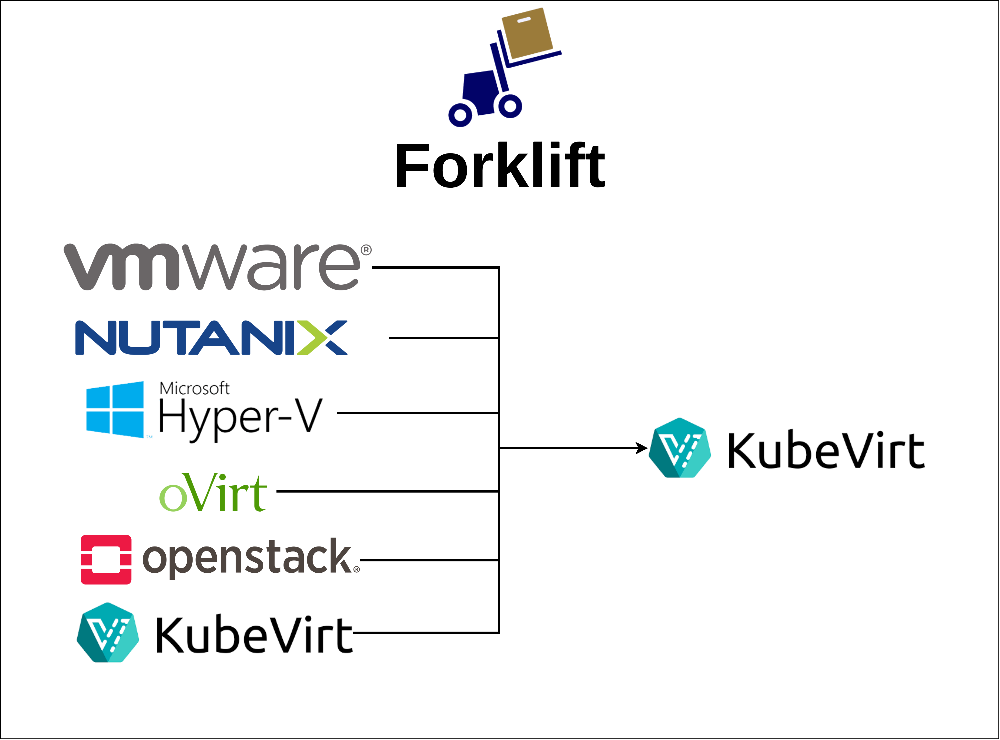

&nbsp;&nbsp;[](https://codecov.io/gh/kubev2v/forklift)

# Forklift
Migrates virtual machines at scale to Kubernetes KubeVirt.
Migrations are performed in a few simple steps, first by providing source and destination credentials,
then mapping the source and destination infrastructure and creating a choreographed plan, and finally,
executing the migration effort.


## Supported providers
- VMware (cold, warm, offload copy)
- oVirt (cold, warm)
- OpenStack (cold)
- Nutanix (cold)
- HyperV (cold)
- Kubevirt (cold, live)

## Features
- **Warm migration** using Change Block Tracking/Incremental Backup to reduce the downtime, supported in VMware and oVirt migrations.
- For VMware migrations, the Forklift uses [virt-v2v](https://libguestfs.org/virt-v2v.1.html) **guest conversions** which installs the virtio drivers and edits the guest to run on QEMU-KVM.
- Migrating to **remote clusters**, user can install the Forklift on one cluster and orchestrate other cluster to do the migration.
- Migrating VMs **between clusters** using the KubeVirt [Export API](https://kubevirt.io/user-guide/storage/export_api/).
- **Validations** of the Virtual Machines to let users know if migration plan has issues that need to be addressed before running.
---

## Deploy
Deploy the Forklift operator index to the cluster.

Create the target namespace first (it is not created automatically):
```bash
kubectl create namespace konveyor-forklift
```

For single-architecture deployment (development):
```bash
make deploy-operator-index PLATFORM=linux/amd64 REGISTRY_TAG=latest
```

For multi-architecture deployment (production):
```bash
make deploy-operator-index-multiarch REGISTRY_TAG=latest
```


## Build
Custom build of the controller, bundle and index which will be deployed to the cluster
```bash
export REGISTRY_ORG=user
make push-controller-image \
     push-operator-bundle-image \
     push-operator-index-image \
     deploy-operator-index
```
Note: The order of targets is important as the bundle needs to be created after controller and index after bundle.

### Multi-Architecture Builds

For information about building images for multiple architectures (AMD64, ARM64) and creating multi-arch manifests, see the [Cross-Platform Build Support](docs/enhancements/cross-platform-build-support.md) enhancement document.
